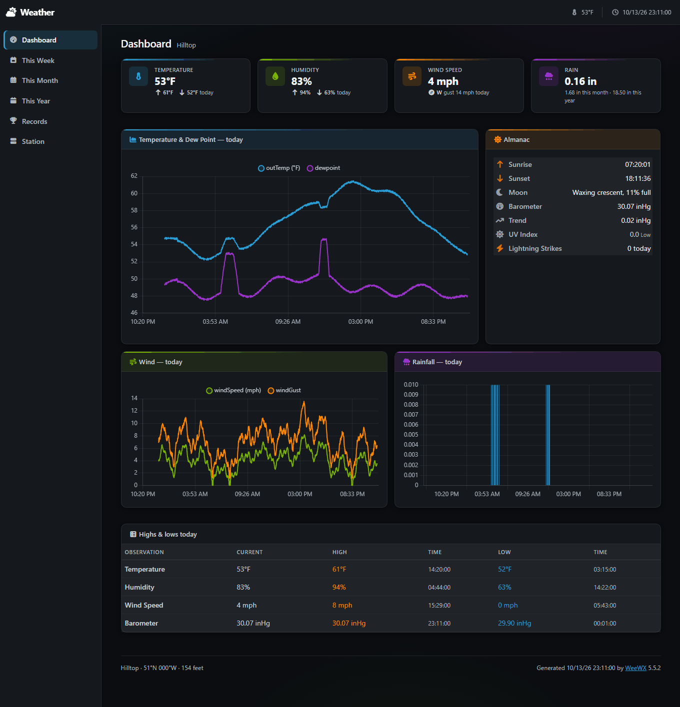

# DarkAdmin: a WeeWX skin, and a complete station installer for the Raspberry Pi

Two things live in this repository:

- **A dark skin for [WeeWX](https://weewx.com/) 5.x.** Six pages on
  Bootstrap 5 (Bootswatch Cyborg), styled after PrepBootstrap's Dark Admin
  theme, with charts drawn in the browser by Chart.js. Its libraries are
  vendored in full: no CDN, no package manager, nothing fetched at runtime.
- **A complete installer for a Raspberry Pi.** One script takes a bare
  Raspberry Pi OS to a running weather station: the RTL-SDR radio software
  (`rtl_433`), WeeWX, the driver that joins the two (`weewx-sdr`) and this
  skin, all installed, configured and checked. It is written for an AcuRite
  Atlas sensor heard by an RTL-SDR dongle. The one thing it leaves to you is
  a web server; see [Opening the pages](#opening-the-pages).



More pictures: [a year of charts](docs/screenshots/year.png) and
[the Station page](docs/screenshots/station.png) with its reception figures.
The station in them is invented, and so is its weather.

Which install is yours:

- **A Raspberry Pi, an RTL-SDR dongle and an AcuRite Atlas:**
  [install the whole station](#install-the-whole-station).
- **A machine that already runs WeeWX 5:**
  [install the skin only](#install-the-skin-only).

## What the pages show

**Dashboard** — current conditions as stat cards, today's temperature/dew
point, wind and rainfall charts, almanac, and today's highs and lows.
**Week / Month / Year** — the same charts over longer periods, with a
highs-and-lows table. **Records** — all-time extremes, rainfall totals, wind
extremes and a month-by-month table. **Station** — location, software and
hardware facts, and a reception-health panel: how many archive records
actually landed, how strongly the antenna hears the sensor, and whether the
sensor's batteries are still good.

- **Values that move.** An open page follows the sensor packet by packet —
  wind speed every 10 seconds, the rest every 30 — and takes over each new
  set of highs, lows and chart points without reloading. See
  [Live values](#live-values).
- **Outage banner.** If nothing has been heard from the sensor for 10
  minutes, a banner says so and for how long. A silent station then reads as
  *"Data is 3 days, 2 h old"* rather than as a broken page — the two are
  otherwise indistinguishable when every value shows `N/A`. With Weather
  Underground set up as a second source, the current readings switch to it
  until the radio is back. See [The outage banner](#the-outage-banner).
- **UV index risk banding.** Colored on the WHO scale — moderate yellow,
  high orange, very high red, extreme violet. Low stays in the body color on
  purpose: coloring the safe case trains the eye to ignore the warning.
- **Missing sensors fold away where they can.** The barometer chart and
  rows, the lightning rows and every highs-and-lows row appear only when
  there is data for them. The temperature, humidity, wind and rain cards are
  fixed, and show `N/A` or "No data for this period" on a station without
  that sensor.

## Install the whole station

`station/install-station.sh` sets up everything on a Raspberry Pi, starting
from a bare Raspberry Pi OS (Debian 13 "trixie") install:

```
RTL-SDR dongle  →  rtl_433  →  weewx-sdr driver  →  WeeWX  →  DarkAdmin report
Weather Underground  →  barometric pressure, and readings while the radio is out
```

It is written for one kind of station: an **AcuRite Atlas** sensor, heard by
an **RTL-SDR dongle** (RTL2832U) on a **Raspberry Pi**, a Pi 5 in particular.
It supports no other sensor. The Atlas has no barometer, so the pressure is
read back from a Weather Underground station, if there is one to name.

### What you need

- A Raspberry Pi running Raspberry Pi OS based on Debian 13 ("trixie"). On
  any other Debian release the installer warns and carries on; it was
  written for Debian 13.
- An RTL-SDR dongle plugged into the Pi, and an AcuRite Atlas with its
  batteries in, within range.
- A network connection (the installer downloads packages) and a user who can
  run `sudo`.
- A Pi that is not already some other weather station; see
  [Later runs and other options](#later-runs-and-other-options).

### Get the repository

On the Pi:

```bash
sudo apt install git
```

```bash
git clone https://github.com/dieseld23/weewx-dark
```

```bash
cd weewx-dark
```

Every command below is run from inside that folder. A Pi that cannot reach
GitHub can be given a copy from another computer instead, with
`scp -r weewx-dark pi@new-pi.local:` from the folder that holds it;
`pi@new-pi.local` stands for your own user and the Pi's name or address.

### A new station

A new station has to be told where it is:

```bash
sudo bash station/install-station.sh --fresh --location "Hilltop" --latitude 51.4779 --longitude -0.0015 --altitude 154,foot
```

Latitude and longitude are in decimal degrees, south and west negative. The
altitude is written as `154,foot` or `47,meter`. The pages are in US units
unless `--units metric` or `--units metricwx` says otherwise. The installer
then listens for the sensor and takes the id of the one AcuRite Atlas it
hears, so the dongle has to be plugged in and the sensor transmitting; with
several Atlases on the air, `--sensor-id HEX` says which is yours.

The run ends with a summary: what WeeWX recorded, what the radio heard, and
whether the pages are being served.

### Opening the pages

The installer installs no web server, and a Pi set up from a bare Raspberry
Pi OS image has none. The pages are plain files in `/var/www/html/weewx`.
Any server whose document root is `/var/www/html` shows them at
`http://<the Pi's address>/weewx/`. nginx, Apache and lighttpd all use that
root on Debian, so on a Pi with nothing else on it, installing one of them
is all it should take:

```bash
sudo apt install nginx
```

Run the installer again afterward, with no options: the `Web` line of its
summary says at what address the pages are being served, or that they are
not. A Pi that already runs Caddy in front of another application needs a
route of its own; see
[Serving the pages at `/weather`](#serving-the-pages-at-weather).

The three addresses in this README, so they are not confused: the station
installer writes to `/var/www/html/weewx` (served at `/weewx/`), `install.sh`
writes to `/var/www/html/weewx-dark` (served at `/weewx-dark/`), and
`/weather/` exists only through the Caddy route.

### Moving a station from another Pi

To bring an existing station over, with its `weewx.conf` and its history,
first stop WeeWX on the Pi it runs on now (called the old Pi from here on);
[Stopping WeeWX on the old Pi](#stopping-weewx-on-the-old-pi) says how. The
installer refuses to copy a database that is still being written. Then, on
the new Pi:

```bash
sudo bash station/install-station.sh --from pi@old-pi.local
```

That copies the old Pi's `weewx.conf` and database over SSH. It only reads
from the old Pi, and its user needs `sudo` without a password there, which
is the Raspberry Pi OS default. When the Pis cannot reach each other, or the
old Pi's `sudo` asks for a password, make a tarball on the old Pi instead
(the same section says how) and hand it over with `--bundle`:

```bash
sudo bash station/install-station.sh --bundle weewx-old-pi.tgz
```

A station brought over keeps what its `weewx.conf` says about where it is
and which sensor is its own. If the old sensor map stored inflated lightning
counts, see [Lightning](#lightning) before the move: the option that clears
them goes on this first run.

### Stopping WeeWX on the old Pi

WeeWX has to be stopped on the old Pi before its database is copied. That
stops WeeWX and the rtl_433 it started, and nothing else that Pi runs:

```bash
sudo systemctl mask --now weewx
systemctl is-active weewx; pgrep -a rtl_433
```

That should print `inactive`, and `pgrep` should find no `rtl_433`. `mask`
rather than `disable`, because the WeeWX package re-enables and starts its
service every time it is upgraded — a routine `apt upgrade` would bring a
disabled WeeWX back. A masked unit stays off (tested across the 5.1.0 →
5.5.2 upgrade). To undo:
`sudo systemctl unmask weewx && sudo systemctl enable --now weewx`.

Leave the old database where it is until the new Pi has run for a while.

The tarball for `--bundle` is made on the old Pi after stopping WeeWX. It
holds `weewx.conf`, which may contain upload passwords, so it is written
where only you can read it:

```bash
(umask 077; sudo tar -C / -czf - etc/weewx/weewx.conf etc/weewx/bin/user var/lib/weewx/weewx.sdb > ~/weewx-old-pi.tgz)
```

Copy it to the new Pi (`scp pi@old-pi.local:weewx-old-pi.tgz .`, or a USB
stick), run the installer with `--bundle weewx-old-pi.tgz`, and delete both
copies once the new Pi is running. The installer keeps one of its own in
`/var/backups/`, readable by root only.

### Later runs and other options

| Run it as | When |
|---|---|
| `--fresh` | First install with no history: new config, empty database. Needs `--location`, `--latitude`, `--longitude` and `--altitude`. |
| `--from USER@OLD-PI` | First install, moving the station: copies the old Pi's `weewx.conf` and database over SSH, so the history comes along. WeeWX on the old Pi must be stopped first. |
| `--bundle FILE.tgz` | The same from a tarball, when the Pis cannot reach each other or the old Pi's `sudo` asks for a password. |
| *(no option)* | Every later run. Re-applies everything to the station already there, the skin included, which is replaced from this folder. It never replaces a config or database in use, and leaves WeeWX running unless something changed or nothing has been recorded for five minutes; then it stops WeeWX for up to two minutes to listen for the sensor, and starts it again. |
| `--wu-station ID` | Any run: names the Weather Underground station the pressure is read from. Needed once; see [Pressure](#pressure). |
| `--wu-key` | A later run that first asks for the Weather Underground API key. The station has to be named already, in an earlier run or with `--wu-station` in the same one. |

`--help` lists the remaining options. Each run is logged to
`/var/log/weewx-station-install.log`.

On a Pi that already has a station, `--fresh`, `--from` and `--bundle` are
ignored unless `--replace-existing` is added to start over; the database and
pages that were there are moved aside, and a copy of `weewx.conf` is kept.
With `--fresh` that `weewx.conf` is not made anew: it stays, and is given
the new place, units and sensor.

"Already has a station" means a `weewx.conf` that says `station_type = SDR`.
A Pi running WeeWX on any other driver counts as empty: `--fresh`, `--from`
and `--bundle` move its database and pages aside (as
`weewx.sdb.replaced-YYYYMMDDHHMMSS`) and rewrite its `weewx.conf` for the
Atlas, keeping the old one beside it. Use the installer on a Pi that is not
already some other weather station.

Nothing about any one station is built in. A new station (`--fresh`) is told
where it is by the four options above, once, and takes the id of the one
sensor it hears; a station brought over (`--from`, `--bundle`) keeps what its
`weewx.conf` says about both. The Weather Underground station is named with
`--wu-station`, once. Every later run reads all of it back from the Pi.

### What the installer does, in order

1. **Checks the machine.** WeeWX files rain and highs and lows by local day,
   so the Pi's timezone has to be the station's. Given
   `--timezone Region/City` the installer refuses to start on a Pi that
   keeps another time (unless `--keep-timezone`); without it, it takes the
   Pi's own zone as right, and on a first install warns when that is UTC or
   another `Etc/` zone.
2. **Fetches the old station** (`--from`) before changing anything on the
   new Pi, so a refusal at this point costs nothing. It only reads from the
   old Pi.
3. **Sets up the radio.** Installs `rtl-433` and `rtl-sdr`, blacklists the
   kernel's DVB-T driver (which otherwise claims the dongle), and writes a
   udev rule giving group `plugdev` the device.
4. **Installs WeeWX** from weewx.com's apt repository. The package starts
   the daemon as soon as it is installed, and on a new machine that daemon
   is the *Simulator*, writing invented weather into a new database — so
   the unit is masked while the package installs.
5. **Installs weewx-sdr 0.87** from the archive vendored in `station/`
   (unmodified; GPLv3, © Matthew Wall).
6. **Installs the skin** from this folder, and `bin/user/darkadminlive.py`
   beside the driver.
7. **Brings the station over** (`--from`, `--bundle`). Stops WeeWX, and
   refuses an old database that fails SQLite's integrity check, is empty, or
   ends in this Pi's future. Installs the old Pi's `weewx.conf` (this Pi's
   is kept as `weewx.conf.before-migration.YYYYMMDDHHMMSS`), the old Pi's
   own `sdr.py` if it differs from the one just installed (which is kept as
   `sdr.py.stock-0.87`), and any other `user.*` module the config names.
   Moves this Pi's database and pages aside, installs the old database, and
   keeps the tarball in `/var/backups/`, readable by root only. The old Pi's
   skins are not copied, so a report that uses one is switched off in the
   next step.
8. **Edits `weewx.conf`** with `configobj`, the library WeeWX itself uses.
   [What the installer changes in `weewx.conf`](#what-the-installer-changes-in-weewxconf)
   lists every edit.
9. **Listens for the sensor** as the `weewx` user, for up to a minute on
   each of two frequencies, and sets rtl_433 to the one that decodes it. The
   AcuRite Atlas transmits on 433.92 MHz, which is tried first. A receiver
   set to 433 MHz decodes it as well, and a config brought over may say
   433 MHz, so that is tried second and kept if it is the one that works. A
   station that is recording, on a run that changed nothing, is not tested
   again, and `--skip-radio-check` leaves the listening out altogether. A
   new station that was given no `--sensor-id` takes the id of the one
   AcuRite Atlas it hears, and stops if it hears none, or more than one;
   for a new station that listening comes before step 8. If a different
   Atlas id is on the air instead of the station's, the installer says so
   and shows the id to pass as `--sensor-id`: the id changes when the
   sensor's batteries are replaced.
10. **Sets up Weather Underground.** A timer that fetches a station's
    observation every five minutes, switched on once there is a station id
    (`--wu-station`) and an API key. See [Pressure](#pressure).
11. **Starts WeeWX**, waits for the first archive record and the first
    page, checks the pages for unresolved template tags and invalid JSON,
    and checks that the live feed is being written.
12. **Schedules security updates for 04:00.** Debian security updates only,
    at fixed times, in place of any automatic-update settings already on
    the Pi. `--no-security-updates` skips the step. See
    [Security updates](#security-updates).

It does not touch the web server; see
[Opening the pages](#opening-the-pages).

### What the installer changes in `weewx.conf`

On a migration it is the old Pi's file, installed as it is, that gets these
edits. Whenever the installer changes the file, it first keeps a copy of it
as it was, beside it, as `weewx.conf.bak.YYYYMMDDHHMMSS`.

- `station_type = SDR`.
- The sensor map, completed for the station's sensor. The sensor map is
  weewx-sdr's table from rtl_433's packet fields to database columns; see
  [Lightning](#lightning) for how it goes wrong.
- The lightning entries and the strike-distance correction described under
  [Lightning](#lightning).
- The rtl_433 frequency, written after the listening in step 9.
- The two services from `darkadminlive.py`, `DarkAdminLive` and
  `WUBarometer`; see [Live values](#live-values).
- The signal figures described under [Reception](#reception).
- `archive_interval = 60`, for a new station (WeeWX's own default is 300)
  and for one brought over alike: any interval longer than a minute is set
  to 60, which puts a point a minute on today's charts. A shorter interval
  is left alone. A station brought over from a Pi that ran at 300 therefore
  changes interval on the day it moves.
- The skin's number formats, repeated under `[[DarkAdmin]]` where the
  config's own `[[Defaults]]` would overrule them; see
  [Number formats](#number-formats).

Three more edits are easy to be surprised by:

- The `[[DarkAdmin]]` report is added, and any other enabled report that
  writes its pages into the same directory, or whose skin is not installed,
  is switched off. On a new install that is WeeWX's own Seasons report,
  whose pages would otherwise be written into `/var/www/html/weewx` as
  well. WeeWX's two upload reports, the ones whose skin is `Ftp` or
  `Rsync`, are left as they are: they send the pages somewhere and write
  none.
- A `barometer = software` under `[StdWXCalculate]` becomes
  `prefer_hardware`: WeeWX would otherwise work the barometer out from a
  station pressure the Atlas does not measure, and overwrite the one read
  from Weather Underground.
- A new station (`--fresh`) gets a `radiation` correction, which fills in
  solar radiation from the light reading.

### Serving the pages at `/weather`

[Opening the pages](#opening-the-pages) covers a Pi with nothing else on it.
This section is for one that already runs **Caddy** in front of another
application. With every path proxied to that application, `/weewx/`,
`/weather/` and anything else end at whatever it answers — its login page,
say — until Caddy is told otherwise.
`sudo ss -ltnp | grep -E ':(80|443) '` shows which server has the ports; a
second one started beside it could not have them.

Caddy can serve the pages itself. In `/etc/caddy/Caddyfile`, inside the
site's block and directly above its `reverse_proxy` line, add the five lines
in the middle here. The rest stands for what is already there and stays as
it is — the name and the port will be whatever yours says, and the block may
hold more:

```
example.com {
    redir /weather /weather/
    handle_path /weather/* {
        root * /var/www/html/weewx
        file_server
    }

    reverse_proxy localhost:8080
}
```

```bash
sudo cp -a /etc/caddy/Caddyfile /etc/caddy/Caddyfile.before-weather
```

```bash
sudo nano /etc/caddy/Caddyfile
```

```bash
sudo caddy adapt --config /etc/caddy/Caddyfile > /dev/null && sudo systemctl reload caddy
```

`reload`, not `restart`: Caddy keeps running the old configuration if it
cannot load the new one, where a restart would leave nothing running. A
warning that the input "is not formatted" is about indentation and can be
ignored. Then check **both** halves, the pages and the application:

```bash
curl -s https://example.com/weather/ | grep -o '<title>.*</title>'
```

```bash
curl -s -o /dev/null -w '%{http_code} %{redirect_url}\n' https://example.com/
```

The first should print the weather page's title, the second what the
application answered before the change: for one that sends visitors to a
login page, something like `302 https://example.com/login`. A bare status
code is not enough for either: where nothing handles a request, Caddy answers
`200` with an empty page. That is what a missing `}` produces. At the end of
the file Caddy does not treat it as an error — `adapt` and `reload` both
accept it, `reverse_proxy` ends up inside the `/weather` block, and every
other address gets that empty `200` in place of the application (tried on
Caddy 2.11.7). To go back:

```bash
sudo cp -a /etc/caddy/Caddyfile.before-weather /etc/caddy/Caddyfile && sudo systemctl reload caddy
```

- `/weather/` answering `403` or `404` means Caddy's user cannot read the
  pages, or there are none yet: `sudo -u caddy ls -l /var/www/html/weewx/index.html`.
- The pages are outside the application's login: anyone who can reach the Pi
  can read them.
- The skin links to everything relatively, so it works under any prefix as
  long as the address ends in a slash; that is what the `redir` line is for.
- Whatever writes the Caddyfile afresh — the application's own installer, a
  Pi rebuilt from scratch — takes the route out again, and the five lines
  have to go back in. A run of `station/install-station.sh` says whether the
  pages are being served.

### Security updates

The last step installs `unattended-upgrades` restricted to Debian's security
archive, and moves Debian's own update timers to fixed times: package lists
refresh at 03:40, updates install at **04:00 local time**.

```bash
systemctl list-timers apt-daily.timer apt-daily-upgrade.timer
```

```bash
less /var/log/unattended-upgrades/unattended-upgrades.log
```

- This is a systemd timer, not a crontab entry. On Debian the update
  machinery is already driven by these two timers; adding a cron job beside
  them would run the same job from two schedulers. The settings live in
  `/etc/apt/apt.conf.d/60security-updates-0400` and two drop-ins named
  `10-security-updates-0400.conf` under `/etc/systemd/system/apt-daily*.timer.d/`.
- **Security only.** The Raspberry Pi kernel and firmware come from
  `archive.raspberrypi.com`, which has no security channel, so they are not
  updated by this; nor is anything from another repository, WeeWX's own
  included. `sudo apt update && sudo apt full-upgrade` by hand covers those.
- It never reboots. `/var/run/reboot-required` appears when an update wants
  one.
- If automatic updates were already configured on the Pi, this narrows them:
  the file above clears any other origins, and the step unmasks and enables
  Debian's two update timers. The installer says so when it finds
  `unattended-upgrades` already installed.
- The step runs on every run of the installer, so `--no-security-updates`
  has to be passed each time to keep it off. To undo it afterward, delete
  `/etc/apt/apt.conf.d/60security-updates-0400` and the two
  `10-security-updates-0400.conf` drop-ins, run
  `sudo systemctl daemon-reload`, restart the two timers
  (`sudo systemctl restart apt-daily.timer apt-daily-upgrade.timer`), and
  use `--no-security-updates` from then on.
- A run missed because the Pi was off waits for the next night
  (`Persistent=false`), so updates never start in the middle of the day.

## Install the skin only

`install.sh` is for a machine that already runs WeeWX 5 from its apt
package: configuration in `/etc/weewx`, a `weewx` user, a systemd unit
named `weewx`, and `sudo` and `rsync` present. On any other layout it stops
at once, saying `/etc/weewx/weewx.conf` was not found; there, copy
`skins/DarkAdmin` into your `SKIN_ROOT` yourself and add the `[[DarkAdmin]]`
report by hand, as shown in [the skin notes](docs/skin-notes.md#the-pieces).
For a bare Raspberry Pi with an AcuRite Atlas, use
[the station installer](#install-the-whole-station) instead.

Get the repository as described under
[Get the repository](#get-the-repository), and from inside its folder:

```bash
./install.sh --configure
```

That deploys the skin to `/etc/weewx/skins/DarkAdmin`, adds a
`[[DarkAdmin]]` report to `weewx.conf` (backing the file up first) and
restarts WeeWX. The pages are written to `/var/www/html/weewx-dark`, a
separate `HTML_ROOT`, so the report already there keeps working. A web
server whose document root is `/var/www/html` serves them at
**`/weewx-dark/`**. Run without `--configure` to install the files and print
the config instead of applying it.

Installing alongside is the default on purpose: it lets you look before you
replace anything. `--configure` has been run against the `weewx.conf` that
WeeWX 5.5.2 ships, not yet on a machine with WeeWX installed; see
[What has been tested](#what-has-been-tested).

`install.sh` installs the skin only. An open page takes over new figures in
place each time WeeWX has generated it again, which is once per archive
interval: every five minutes with WeeWX's own `archive_interval = 300`.
For values that move between reports, copy `bin/user/darkadminlive.py` into
`/etc/weewx/bin/user/`, add `user.darkadminlive.DarkAdminLive` to
`report_services` as shown under [Live values](#live-values), and restart
WeeWX (`sudo systemctl restart weewx`). The other service shown there,
`WUBarometer`, is only for the Weather Underground pressure, which the
station installer sets up.

### Promoting it to the main URL

Once you are happy with it, point the report at the main root and turn the
old one off:

```ini
[StdReport]
    [[DarkAdmin]]
        HTML_ROOT = /var/www/html/weewx     # was /var/www/html/weewx-dark
    [[SeasonsReport]]                       # or whichever report had that address
        enable = false
```

Move the previous report's output aside first rather than generating over
it — otherwise the old skin's files linger in the directory forever:

```bash
sudo mv /var/www/html/weewx /var/www/html/weewx-old-$(date +%Y%m%d)
sudo mkdir -p /var/www/html/weewx && sudo chown weewx:weewx /var/www/html/weewx
cd /tmp && sudo -u weewx weectl report run DarkAdmin --config=/etc/weewx/weewx.conf
sudo systemctl restart weewx
```

To go back: re-enable the previous report, point `[[DarkAdmin]]` at a spare
`HTML_ROOT`, and move the old report's pages back to where they were.
The copy of `weewx.conf` that `install.sh --configure` saved before it added
the report is there as well, as `/etc/weewx/weewx.conf.bak.YYYYMMDDHHMMSS`
(the date and time it ran).

## Settings

Both installers replace the installed copy of the skin, `skin.conf`
included, every time they run. So do not edit
`/etc/weewx/skins/DarkAdmin/skin.conf`. Either edit `skin.conf` in this
folder and install again, or put the setting in `weewx.conf`, where the
report's own section outranks `skin.conf` and is left alone by both
installers:

```ini
[StdReport]
    [[DarkAdmin]]
        [[[Extras]]]
            outage_seconds = 1800
```

| Setting | In `skin.conf` under | Default | What it does |
|---|---|---|---|
| `brand` | `[Extras]` | `Weather` | The name at the top left of every page. |
| `outage_seconds` | `[Extras]` | `600` | How long the sensor may be silent before [the outage banner](#the-outage-banner) appears. |
| `live_seconds` | `[Extras]` | `5` | How often an open page looks for [live values](#live-values). `0` turns that off. |
| `refresh_seconds` | `[Extras]` | `30` | How often an open page checks whether WeeWX has generated it again. `0` turns that off. |
| `observations_current` | `[DisplayOptions]` | | The rows of the Station page's "Current readings" table. |
| `observations_period` | `[DisplayOptions]` | | The rows of the highs-and-lows tables and of the Records table. The charts are fixed. |

The pages are in English only. Headings and card titles are in the
templates and observation names in `skin.conf` under `[Labels]`; WeeWX's
`lang` files are not used.

[Number formats](#number-formats) covers the whole-number temperatures and
how to get the decimals back.

## Updating and removing

**Updating.** Bring the folder up to date and run the same installer again:

```bash
git pull
```

```bash
sudo bash station/install-station.sh
```

For the skin alone the second command is `./install.sh`. A folder that was
copied with `scp` rather than cloned is copied again; remove the old one
first (`ssh pi@new-pi.local "rm -rf weewx-dark"`), because copying over it
prints "Permission denied" for every file under `.git` (Git keeps those
read-only) and ends with an error status. WeeWX itself is upgraded by hand
(`sudo apt update && sudo apt install weewx`); the package keeps your
`weewx.conf`.

**Removing the skin.** Take the `[[DarkAdmin]]` section out of
`weewx.conf` (and turn the report it replaced back on), restart WeeWX, then
delete `/etc/weewx/skins/DarkAdmin` and the report's `HTML_ROOT`.

**Removing what the station installer added.** The order matters for the
first step: WeeWX does not start while `weewx.conf` names a module that is
gone.

1. In `weewx.conf`, take `user.darkadminlive.WUBarometer` out of
   `data_services` and `user.darkadminlive.DarkAdminLive` out of
   `report_services`, take the `[[DarkAdmin]]` section out, turn back on
   any report the installer switched off, and restart WeeWX. Then delete
   `/etc/weewx/bin/user/darkadminlive.py`, `/etc/weewx/skins/DarkAdmin` and
   `/var/www/html/weewx`. The installer's other `weewx.conf` edits can stay
   where they are; the `weewx.conf.bak.` copies beside the file show it as
   it was before each run that changed it.
2. Weather Underground: `sudo systemctl disable --now weewx-wu-poll.timer`,
   then delete `weewx-wu-poll.service` and `weewx-wu-poll.timer` from
   `/etc/systemd/system/`, and `/etc/default/weewx-wu`, and run
   `sudo systemctl daemon-reload`.
3. Security updates: as described under
   [Security updates](#security-updates).
4. Radio: delete `/etc/modprobe.d/blacklist-rtl-sdr.conf` and
   `/etc/udev/rules.d/61-rtl-sdr-weewx.rules`.

That leaves WeeWX itself, its apt source, the `rtl-433` and `rtl-sdr`
packages, the `weewx` user's membership of `plugdev`, and any tarball kept
in `/var/backups/`; removing those is ordinary package housekeeping.

## Reference

### Live values

WeeWX generates its pages once per archive interval (a minute on a station
the installer set up; WeeWX's own default is five), and a generated page
never changes in the browser. The live values, the pressure and the
stand-in readings go beyond that, and come from
`bin/user/darkadminlive.py`, which the installer copies to
`/etc/weewx/bin/user/` and names in `weewx.conf`:

```ini
[Engine]
    [[Services]]
        data_services = user.darkadminlive.WUBarometer
        report_services = user.darkadminlive.DarkAdminLive, weewx.engine.StdPrint, weewx.engine.StdReport
```

The services read the settings of the report named `DarkAdmin`. If yours
has another name, add a `[DarkAdminLive]` section with `report = YourName`
to `weewx.conf`.

`DarkAdminLive` writes `data/live.json` on every packet from the sensor,
formatted with the report's own units, and an open page reads it every 5
seconds (`live_seconds`). How often a value actually changes is the
sensor's doing: the Atlas sends wind speed every 10 seconds and
temperature, humidity, wind direction, UV and light every 30. Highs, lows,
rain totals and charts still come from the archive records; an open page
checks every 30 seconds (`refresh_seconds`) whether WeeWX has generated it
again and takes over the new figures in place, with no reload. A tab in the
background stops asking and catches up when it is looked at again.

### Pressure

The Atlas has no barometer. An AcuRite display indoors has one, and can
report to Weather Underground as a station there. The installer is told
that station's id once, here `KXXEXAMPLE1`:

```bash
sudo bash station/install-station.sh --wu-station KXXEXAMPLE1
```

Once there is an API key as well (below), `weewx-wu-poll.timer` asks Weather
Underground's API for that station's current observation every five minutes
and writes it to `data/wu.json`;
`WUBarometer` adds its pressure to WeeWX's packets as `barometer`, where it is
archived, charted and trended like any other reading. A pressure more than
20 minutes old is not used: the page shows `N/A` rather than a number nobody
measured. (That limit is `wu_max_age`, in seconds, in the `[DarkAdminLive]`
section of `weewx.conf`; 1200 unless it is set there.)

This needs an API key, which Weather Underground issues to the owner of a
reporting station at <https://www.wunderground.com/member/api-keys>. Then, on
the Pi:

```bash
sudo bash station/install-station.sh --wu-key
```

It asks for the key without showing it, stores it in `/etc/default/weewx-wu`
(readable by root only), makes one request, and says what came back — the
pressure and which software sent it, or why not. The key goes nowhere else:
not into `weewx.conf`, not into the installer's log, not into anything under
the web root. Typing it into that file by hand and running the installer
again does the same. Without a station id and a key the timer stays off and
the pressure rows stay folded away.

With the key already in hand, the station and the key can go in together:
`sudo bash station/install-station.sh --wu-station KXXEXAMPLE1 --wu-key`.

To see when the timer runs next, and what it last had to say:

```bash
systemctl list-timers weewx-wu-poll.timer
```

```bash
sudo journalctl -u weewx-wu-poll -n 20
```

The journal gets a line when the state changes — first good answer, a
refused key, nothing recent from the station — not one every five minutes.

A few more things about the pressure:

- Pressure history starts when the key goes in. It is Weather Underground's
  sea-level figure, to two decimals, fetched every five minutes — so it moves
  in steps, and the three-hour trend needs three hours of it.
- If `weewx.conf` is itself set to upload to Weather Underground as the same
  station, `WUBarometer` takes no pressure from there (WeeWX would be reading
  its own upload back) and the installer says so.
- To switch the Weather Underground part off, empty the key in
  `/etc/default/weewx-wu` (leave `WU_API_KEY=` with nothing after it) and run
  the installer again, which stops the timer.
  `sudo systemctl disable --now weewx-wu-poll.timer` on its own lasts only
  until the installer's next run, which starts the timer again while a
  station and a key are stored. Either way the pressure goes to `N/A` twenty
  minutes later; the outage banner still appears, without a stand-in.

### The outage banner

Everything the Atlas measures comes from the radio; Weather Underground
only stands in. When nothing has been heard from the sensor for
`outage_seconds` — 600, ten minutes — every page says so in a banner, and
one of three things is shown:

| The banner says | Meaning | The readings are |
|---|---|---|
| *Nothing from the sensor's radio for 14 min* | Weather Underground has an observation under 20 minutes old that is more than 2 minutes newer than the radio's last. | Weather Underground's copy. Anything it has no value for (light level, strike distance) is dimmed. |
| *Data is 14 min old* | Weather Underground is not set up, or has nothing that recent or that much newer. | The last ones on record. |
| *This page has lost touch with the station* | The browser cannot reach the Pi at all. | Whatever was last fetched. |

The banner goes, and the radio's values return, with the first packet that
arrives. The banner itself is part of the skin and needs nothing else; the
first row needs the Weather Underground part of [Pressure](#pressure). The
20 and the 2 minutes are fixed in `js/weewx-dark.js`.

What this does and does not cover:

- The stand-in covers failures on the Pi's side — dongle, antenna, rtl_433,
  WeeWX itself. Weather Underground's copy comes from the same sensor by way
  of the display, so if the Atlas itself stops (batteries), Weather
  Underground stops with it and the second banner is the one that appears.
- Nothing from Weather Underground is written to the database except the
  pressure, and during a radio outage nothing is written at all: WeeWX only
  makes a record when packets arrive. Charts, highs and lows have a gap for
  the outage, which is what happened.

The script measures ages against the web server's clock, taken from the
`Date` header of the answer to its `data/live.json` request, not against
the browser's: a phone whose clock is ten minutes out would otherwise
announce an outage that is not happening. With `live_seconds = 0` there is
no such request, and the browser's clock is used.

### Reception

The Station page's **Reception health** panel answers two questions: are the
sensor's packets arriving, and how well does the antenna hear them.

**Are they arriving.** The records written today and this week, and how much
of each period they account for — *98% of the day so far on record*. Each
record counts for its own interval, so the figure survives a change of
`archive_interval`. WeeWX writes no record for a minute in which nothing
arrived, so a figure under 100% is lost minutes, not lost packets.

**How well.** rtl_433 measures every packet it decodes, and with `-M level`
on its command line it reports three figures with each one:

| On the page | rtl_433 | Stored as | Meaning |
|---|---|---|---|
| Signal-to-Noise | `snr` | `signal2` | How far the sensor stands above the background, in dB. The figure to watch while moving the antenna. |
| Signal Level | `rssi` | `signal1` | How strongly the sensor arrives, in dB below the most the receiver can take in, so it is negative. |
| Noise Floor | `noise` | `noise` | The background the sensor has to beat, on the same scale. Lower is quieter. |

Each card shows the latest packet's figure, moving with the live feed, and
under it the day's lowest and highest. Signal-to-noise also gets a word:
**Strong** from 20 dB, **Fair** from 12, **Weak** below that. Those bands are
this skin's own rule of thumb, not rtl_433's — `station.html.tmpl` and
`js/weewx-dark.js` hold the same two numbers — so set them against what your
own antenna shows on a good day.

**Sensor Battery** reads **OK** or **Low**. The Atlas says only whether its
batteries are still good; weewx-sdr stores that as 0 for good and 1 for low.

The station installer writes these lines to `weewx.conf` for you. If you
installed only the skin with `install.sh`, and your station is an AcuRite
Atlas read through weewx-sdr, add them by hand, with your own sensor's id:

```ini
[SDR]
    cmd = rtl_433 -M utc -F json -M level
    [[sensor_map]]
        signal1 = rssi.1A2B.AcuriteAtlasPacket
        signal2 = snr.1A2B.AcuriteAtlasPacket
        noise = noise.1A2B.AcuriteAtlasPacket
```

- `-M level` is added to the end of whatever `cmd` already holds. A command
  that also hops to a second frequency, or copies its messages to a second
  output, keeps all of that; the extra fields go to every output.
- `signal1`, `signal2` and `noise` are all columns of WeeWX's
  `wview_extended` schema. A database begun before WeeWX 4.0 has the older
  schema without them, and WeeWX drops what it has no column for without a
  word (see [Lightning](#lightning) for the same trap). The installer
  checks, and says which column is missing and how to add it. Without the
  columns the cards still show the figures as they arrive, from the live
  feed, but not the day's range.
- weewx-sdr drops a packet that is identical to the one before it, which is
  how the Atlas's three copies of each transmission become one. With
  `-M level` the copies' levels can differ, so they are no longer identical
  and each may reach WeeWX. Nothing that is stored depends on which happens:
  rain and lightning are stored as the change in a running total, and a
  repeat changes nothing.
- The figures describe packets that were decoded. A packet too weak to
  decode leaves no figure at all, so a signal-to-noise that reads Fair beside
  a record count that keeps falling short means the weak ones are being lost.

### Lightning

The AcuRite Atlas reports lightning as a **running strike total**
(`strike_count`, wrapping at 512) and the distance of the last strike. A
sensor map — weewx-sdr's table from rtl_433's packet fields, on the right,
to database columns, on the left — can get that wrong twice.

Sent to names that are not database columns, both are dropped. WeeWX does
not warn about it: with a map that says `strikeCount = strike_count...`, it
decodes every lightning reading the Atlas sends, finds nowhere to put it,
and throws it away, and `SELECT COUNT(lightning_strike_count) FROM archive`
returns 0 across the entire history. The real column names are
`lightning_strike_count` and `lightning_distance`. To check a map against
the schema:

```bash
sudo sqlite3 /var/lib/weewx/weewx.sdb "PRAGMA table_info(archive);" | cut -d'|' -f2
```

Anything on the left of a sensor-map entry that is neither in that list nor
named in `[[deltas]]` is being discarded.

Sent straight onto `lightning_strike_count` — a column WeeWX *sums* over
each archive interval — the total is added again by every packet: with the
counter at 40 and six packets a minute, each one-minute record stores 240
"strikes", and every strike count recorded under that map is inflated.

The right shape is the one the driver uses for rain — map the total to a
scratch name and let `[[deltas]]` store the change:

```ini
[SDR]
    [[sensor_map]]
        strikes_total      = strike_count.1A2B.AcuriteAtlasPacket
        lightning_distance = strike_distance.1A2B.AcuriteAtlasPacket
    [[deltas]]
        rain = rain_total
        lightning_strike_count = strikes_total
```

`rain` has to be listed: a `[[deltas]]` section *replaces* the driver's
defaults rather than adding to them, and without that line rainfall silently
stops being recorded.

The installer makes this change. A database brought over from a station
whose map sent the running total straight to `lightning_strike_count` still
holds the inflated counts, and the migration clears them only when it is
told the day that map went in:

```bash
sudo bash station/install-station.sh --from pi@old-pi.local --fix-lightning-since 2024-06-15
```

That sets `lightning_strike_count` to NULL from that day's midnight on, in
the copy of the database it installs, and resets the daily summaries for that
column. The true per-interval counts cannot be recovered from the sums, so
the stretch reads as "no data" rather than as millions of strikes. The old
Pi's database is not modified, and the tarball the installer keeps in
`/var/backups/` has the original values. Without the option the history is
left as it was, and the installer says so when the old config has that map.

On a Pi that has already been brought over, the counts are cleared by
bringing the station over once more, with `--replace-existing`, from the old
Pi or from that tarball (its name ends in the time of the run that kept it):

```bash
sudo bash station/install-station.sh --bundle /var/backups/weewx-old-pi-20240615120000.tgz --replace-existing --fix-lightning-since 2024-06-15
```

That puts the old Pi's database in place of the one in use. What this Pi has
recorded since the move is not carried over: its database is moved aside
as `weewx.sdb.replaced-YYYYMMDDHHMMSS`. It is best done soon after the move.

Strike distance comes through rtl_433 undecoded, as a 0–31 value believed to
be miles, with 31 meaning "none". A `[StdCalibrate]` correction drops the
31s, and the dashboard shows the distance only on a day that has had
strikes, prefixed "about".

### Number formats

Temperature and wind are whole numbers wherever one is printed (humidity is
whole as well, by WeeWX's own default); rain keeps its decimals, and
pressure keeps two in inHg. That is `degree_F = %.0f` (and
`degree_C = %.0f`, for pages in metric units) under
`[Units] [[StringFormats]]` in `skin.conf`, which covers every temperature
the skin prints — dew point, heat index and wind chill included — and the
live values with them. WeeWX already prints mph, km/h and knots without
decimals; `meter_per_second = %.0f` there does the same for m/s, and
`inHg = %.2f` takes the place of WeeWX's three decimals. The database is
not touched: it keeps what the sensor sent. Deleting those lines from
`skin.conf` in this folder and installing again brings the decimals back.

The charts print a value the same way when one is read off them: each
`data/*.json` file carries the formats of its temperature and wind series,
and the tooltip and the axis labels follow them. The lines themselves are
drawn from the figures as measured, to two decimals. Rounding the points
instead makes a line climb in one-degree steps — and `.round(0)` is not even
rounding: WeeWX's helper cuts the decimals off when asked for zero places,
so 61.9 becomes 61.

One catch on the pages: anything set in `[StdReport] [[Defaults]]` in
`weewx.conf` outranks `skin.conf`, and a `weewx.conf` from an older WeeWX
may list its formats there, `degree_F = %.1f` among them. The station
installer looks for that, and repeats the skin's format in the report's own
`[[DarkAdmin]]` section, which outranks both. It marks each line it puts
there with a comment and keeps the marked ones in step with `skin.conf` on
every later run: a format changed in `skin.conf` is changed there, one taken
out of `skin.conf` is taken out there. A format under `[[DarkAdmin]]` with no
such mark is taken for your own and left alone. With `install.sh` alone, do
all of this by hand if the temperatures keep their decimal.

### Things worth knowing afterward

- `sudo journalctl -u weewx -f` follows WeeWX. Each time it stops, the driver
  logs a `ValueError: PyMemoryView_FromBuffer()` traceback from `sdr.py`. It
  is harmless.
- Do not replace the packaged rtl_433 25.02 with a build from source: newer
  rtl_433 renames the Atlas's `uv` field to `uvi`, which driver 0.87 does not
  read, and the UV index would quietly go blank.
- The week, month and year charts are not rebuilt with every report: the
  week's at most hourly, the month's every three hours, the year's twice a
  day. The newest point on those charts can be that old; only today's
  charts follow every report.

### What has been tested

What was run, and what was not.

**Run as a whole installer**, on an earlier version of it: the full
migration, the fresh install, re-runs and the failure cases (no dongle,
wrong frequency, changed sensor id, bad tarball, wrong timezone, old Pi
still running), in Debian 13 and Debian 12 containers with a simulated
sensor. The rain and strike totals WeeWX stored were compared against what
the simulated sensor sent. What was added or changed after those runs was
not in them: the options that say where a new station is, the search for
the sensor's id, the signal figures, the one-minute charts and
`--fix-lightning-since`.

**Tested in pieces**, with stand-ins for the radio, systemd, the database
or Weather Underground, and not in a run of the whole installer:

- The installer's `weewx.conf` edits, run twice each against a new config,
  a migrated one whose `cmd` hops to a second frequency, one with a
  30-second archive and `-M level` already in place, and one with number
  formats in `[[Defaults]]`.
- The options that say where a new station is, the search for the sensor's
  id and what it leaves in `weewx.conf`, the Weather Underground part
  staying off until a station is named, and `--fix-lightning-since`.
- The signal figures and the one-minute charts, on WeeWX 5.5.2 with driver
  0.87 and a stand-in for rtl_433 that sends Atlas messages with the
  `-M level` fields: three copies of each transmission, each with slightly
  different levels so that none is dropped as a duplicate. The figures were
  followed into the archive, the live feed and the Station page. The
  whole-number temperatures and winds were checked on every page and in
  the charts' tooltips.
- The Weather Underground side, against a stand-in for its API answering
  each way the real one can (an observation, gzip-compressed or not, no
  recent data, a refused key, a body that is not JSON, no pressure, a stale
  observation, no answer at all), and the banners by silencing the
  simulated sensor and stopping the web server under an open page.
- `install.sh --configure`, against the `weewx.conf` that WeeWX 5.5.2
  ships, with stand-ins for `sudo`, `rsync` and `systemctl`, and the result
  read back with `configobj`.

**Not tested:**

- The signal figures of a real dongle. The stand-in's are invented, so what
  a real dongle reports for them was not seen.
- Weather Underground itself. The first real request is the one a Pi makes
  with its own key.
- `install.sh` on a machine with WeeWX installed.
- A `--fresh` install from start to finish on a Pi, in the installer's
  present form.

## Changing the skin

[docs/skin-notes.md](docs/skin-notes.md) has notes on how a WeeWX skin is
put together, the traps this one ran into, how its chart data is made, and
how to check a change.

## Repository layout

```
install.sh               install the skin on a machine that already runs WeeWX
station/
  install-station.sh     set up the whole station on a Raspberry Pi
  weewx-sdr-0.87.zip     the rtl_433 driver it installs (third-party, GPLv3)
skins/DarkAdmin/         the skin: templates, skin.conf, css/, js/, vendor/
bin/user/
  darkadminlive.py       WeeWX services behind the live values and the
                         pressure, and the Weather Underground poller
docs/
  skin-notes.md          notes for changing the skin
  screenshots/           the pictures above
LICENSE                  MIT
THIRD-PARTY-NOTICES.md   what is vendored, and under which licenses
```

## Third-party assets

Vendored under `skins/DarkAdmin/vendor/` so the skin runs with no network
access at all — a weather station on a LAN should not depend on a CDN.

| Component | Version | License |
|---|---|---|
| Bootstrap | 5.3.8 | MIT |
| Bootswatch's Cyborg theme, which Bootstrap's CSS is built with | 5.3.8 | MIT |
| Popper, inside `bootstrap.bundle.min.js` | 2 | MIT |
| Font Awesome Free | 7.3.1 | Icons CC BY 4.0, fonts SIL OFL 1.1, code MIT |
| Chart.js | 4.5.1 | MIT |
| @kurkle/color, inside `chart.umd.min.js` | 0.3.2 | MIT |

[THIRD-PARTY-NOTICES.md](THIRD-PARTY-NOTICES.md) has their copyright lines
and license terms.

The Bootswatch build has had its Google Fonts `@import` removed and is
otherwise as published.

The skin's look and layout follow Dark Admin, a free Bootstrap 3 theme by
PrepBootstrap. None of that theme's files are shipped; the notices say more.

`station/weewx-sdr-0.87.zip` is Matthew Wall's
[weewx-sdr](https://github.com/matthewwall/weewx-sdr) driver, unmodified,
under the GPLv3 (its `license` file is inside the archive). It is a separate
work, kept here so the station installer can install the version everything
here was tested with, without depending on a download.

Everything else — the templates, CSS and JS written for the skin,
`bin/user/darkadminlive.py` and the two installers — is covered by
[LICENSE](LICENSE).
